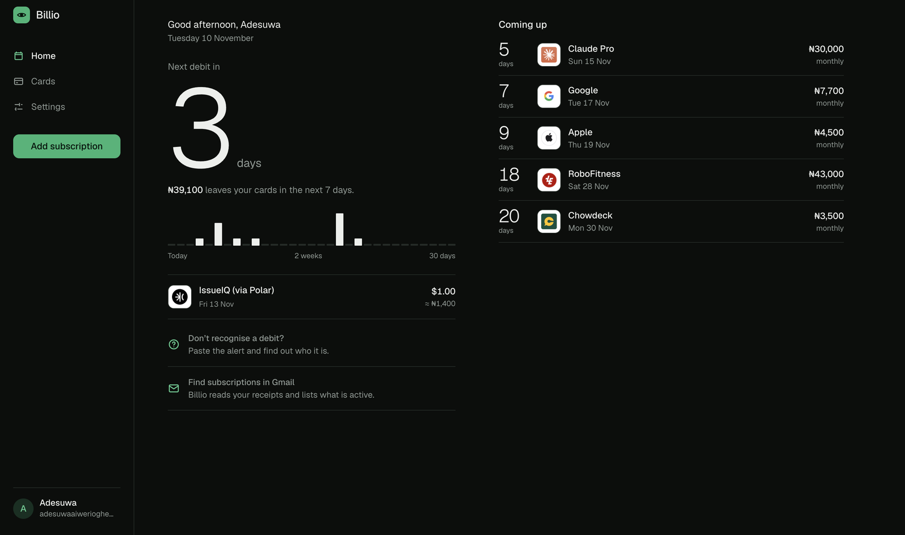
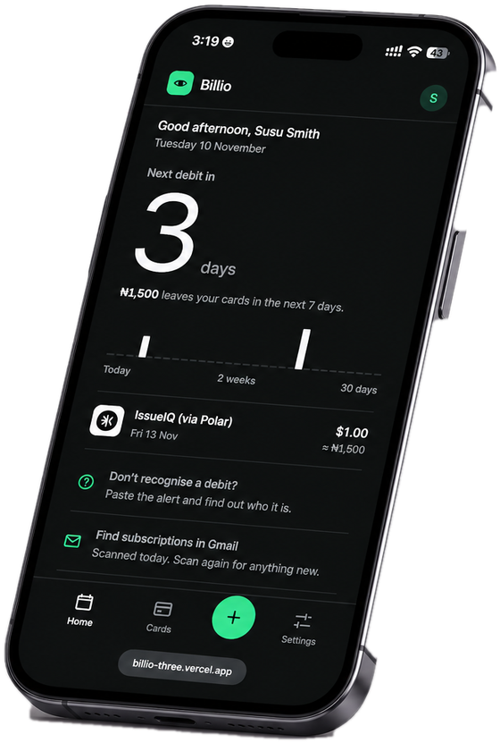
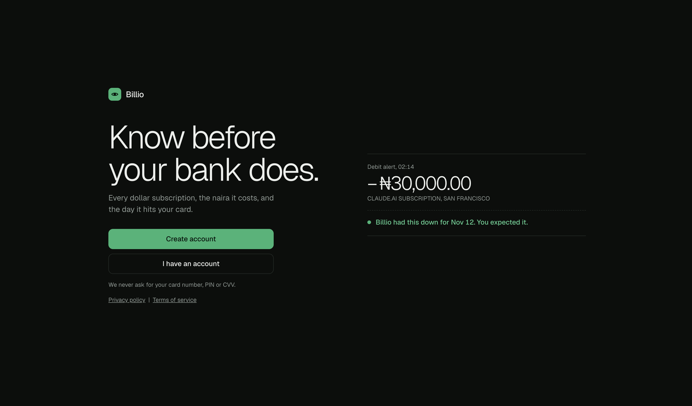

# Billio

Know what's about to hit your card. Billio tracks foreign subscriptions paid by card in Nigeria, counts down to the next charge, and emails you before it lands, so a forgotten renewal doesn't turn into a surprise debit alert.

Live: https://billio-three.vercel.app



<p align="center">
  
</p>



## What it does

- **Countdown to the next charge.** Add a subscription once and Billio works out the next billing date from its cycle (weekly, monthly, yearly).
- **Naira and dollar aware.** Track charges in NGN, USD, EUR or GBP and tie each one to the card it bills.
- **Find subscriptions in Gmail.** Reads your receipt and renewal emails, lists what looks active, and lets you tick what to add. It runs in your browser, read-only, and nothing is uploaded.
- **Reminder emails.** A daily job emails you 3 days, 1 day and on the day a charge is due.
- **Sync across devices.** Sign in and your cards and subscriptions follow you. Works offline and syncs when you're back online.
- **Installable.** A PWA with a phone-first layout.

## Stack

- Vite, React 19, TypeScript, React Router, Zustand
- Supabase for auth, Postgres with row-level security, and an Edge Function
- Resend for reminder emails
- Gmail API through Google Identity Services (`gmail.readonly`)
- Vercel for hosting

## Run it locally

```bash
npm install
cp .env.example .env   # then fill in the values below
npm run dev            # http://localhost:5233
```

Without Supabase keys the app still works, saving everything on the device only.

### Environment variables

| Name | What it is |
| --- | --- |
| `VITE_GOOGLE_CLIENT_ID` | Google OAuth web client ID, for Gmail import |
| `VITE_SUPABASE_URL` | Your Supabase project URL |
| `VITE_SUPABASE_KEY` | Your Supabase publishable (anon) key |

## Set up the backend

1. Create a Supabase project and run `supabase.sql` in the SQL editor. It creates the tables and their row-level security policies.
2. Deploy the reminder function in `supabase/functions/send-reminders` and set these secrets: `CRON_SECRET`, `RESEND_API_KEY`, and optionally `REMINDER_FROM` and `APP_URL`.
3. Turn off "Verify JWT" for that function. It authenticates with the `x-cron-secret` header instead.
4. Enable `pg_cron` and `pg_net`, then schedule a daily call to the function. Billio uses `0 6 * * *` UTC, which is 7am in Lagos.

The function accepts `?dry=1` to preview what it would send and `?force=1` to resend.

Note: Resend's test sender only delivers to the account owner. To email other people, verify a domain in Resend and set `REMINDER_FROM`.

## Set up Gmail import

1. In Google Cloud Console, create a project and enable the Gmail API.
2. Configure the OAuth consent screen with the `gmail.readonly` scope.
3. Create an OAuth client ID (Web application) and add your local and deployed URLs under Authorized JavaScript origins.
4. Put the client ID in `VITE_GOOGLE_CLIENT_ID`.

Google treats `gmail.readonly` as a restricted scope. In Testing mode you can add up to 100 test users with no review. If you publish without verification, users see an "unverified app" warning and the app is capped at 100 new users. Full verification needs a custom domain, a privacy policy, and a demo video.

## How the Gmail scan works

Billio searches the last 400 days of receipt, invoice, renewal and membership emails, reads headers first, and only opens the full message when it needs an amount or date. It then:

- matches known merchants, and guesses unknown senders only when the email clearly says renewal or subscription
- pulls out the amount, currency, billing cycle and next billing date
- pulls the real app name out of Apple receipts, which cover Apple Music, iCloud+ and App Store subscriptions
- drops order, delivery and promo emails
- hides anything already tracked or marked "Not a subscription"

It is rule-based, so it can miss things. Amounts that sit only inside a PDF attachment aren't read yet, and Billio asks you to type them.

## Project layout

```
src/lib        gmail scan, sync, store, supabase client
src/pages      screens (Welcome, Upcoming, Add, Prefs, Auth)
src/components shared UI (sheets, rows, Gmail results)
supabase/      edge function for reminder emails
supabase.sql   database schema and policies
public/        privacy and terms pages
```

## Privacy

Gmail access is read-only and happens in your browser. Email contents are never stored or sent to a server. See `public/privacy.html`.
